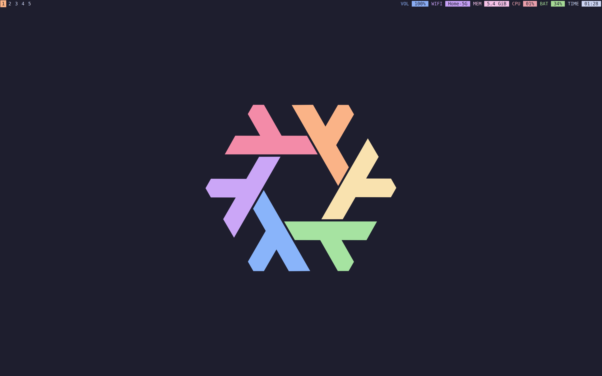
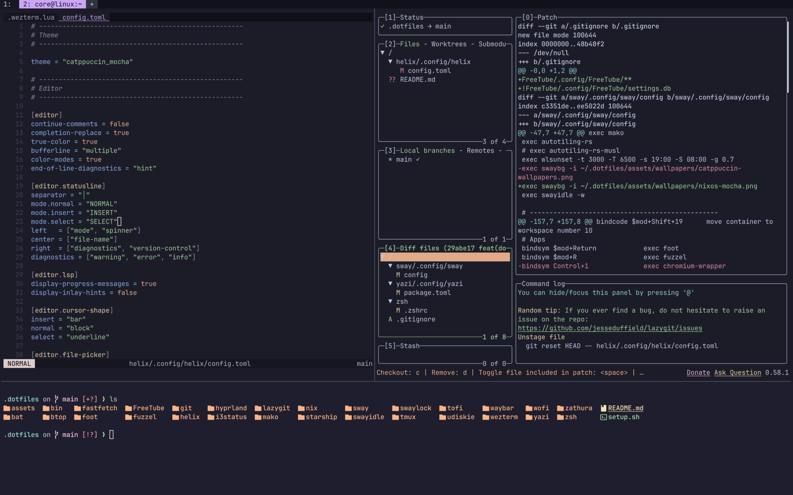
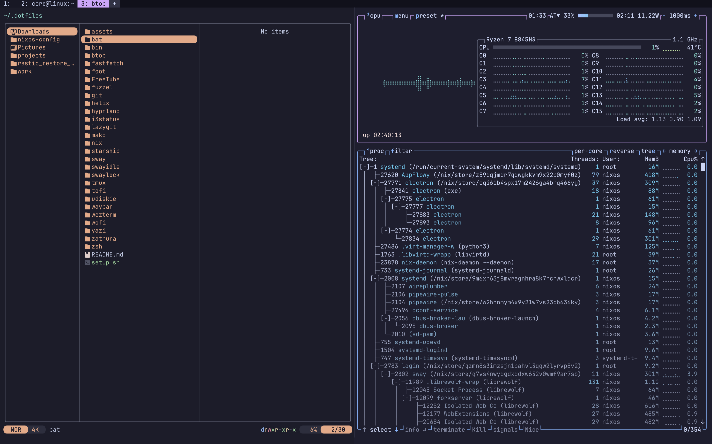

# HX dots

A fast, keyboard-driven Wayland environment built for deep focus. Minimal surface, maximal efficiency.
Powered by Mango, Quickshell, and a focused set of desktop and development tools.

## Showcase

 

<h2>
  
  Desktop
</h2>

### Mango Ecosystem

| Description        | Tool                                           | Language |
| :----------------- | :--------------------------------------------- | :------: |
| Wayland compositor | [Mango](https://github.com/mangowm/mango)      |  ![][c]  |
| Idle daemon        | [swayidle](https://github.com/swaywm/swayidle) |  ![][c]  |
| Screen locker      | [swaylock](https://github.com/swaywm/swaylock) |  ![][c]  |
| Shell panels, notifications, and launcher | [Quickshell](https://quickshell.org/) | ![][cpp] |

### Wayland Utilities

| Description              | Tool |
| :----------------------- | :--- |
| Terminal                 | [foot](https://codeberg.org/dnkl/foot) |
| Screenshots and recording| `hx-screenshot`, `hx-record` |
| Display and audio controls | Quickshell |

 

<h2>
  
  Development Environment
  
</h2>

| Category | Role | Tool |
| :------- | :--- | :--- |
| Shell | Interactive shell and plugins | [zsh](https://www.zsh.org/) / [Zinit](https://github.com/zdharma-continuum/zinit) |
| Shell | Prompt | [Starship](https://starship.rs/) |
| Terminal | Terminal emulators | [WezTerm](https://wezterm.org/) / [foot](https://codeberg.org/dnkl/foot) |
| Editor | Modal editor | [Helix](https://github.com/helix-editor/helix) |
| Files | Terminal file manager | [Yazi](https://yazi-rs.github.io/) |
| Git | Git tools | [lazygit](https://github.com/jesseduffield/lazygit), [gh-dash](https://github.com/dlvhdr/gh-dash), [delta](https://github.com/dandavison/delta) |
| Development | AI coding assistant | [OpenCode](https://opencode.ai/) |
| Development | Kubernetes terminal UI | [k9s](https://github.com/derailed/k9s) |

 

## User Applications

| Category     | Role                   | Tool |
| :----------- | :--------------------- | :--- |
| System       | Resource monitor       | [btop](https://github.com/aristocratos/btop) |
| System       | System information     | [fastfetch](https://github.com/fastfetch-cli/fastfetch) |
| Browser      | Web browser            | Chromium |
| Media        | YouTube desktop client | [FreeTube](https://github.com/FreeTubeApp/FreeTube) |
| Media        | Audio/video player     | [mpv](https://mpv.io/) |
| Images       | Image viewer           | [imv](https://sr.ht/~exec64/imv/) |
| Productivity | Document / PDF viewer  | [zathura](https://github.com/pwmt/zathura) |
| Productivity | Web apps               | Notion, Paperless-ngx, Vaultwarden, WhatsApp, and others |

<!-- Language badges -->

[rs]: https://img.shields.io/badge/-rust-orange
[sh]: https://img.shields.io/badge/-shell-green
[go]: https://img.shields.io/badge/-go-68D7E2
[cpp]: https://img.shields.io/badge/-c%2B%2B-red
[c]: https://img.shields.io/badge/-c-lightgrey
[ts]: https://img.shields.io/badge/-TS-007BCD
